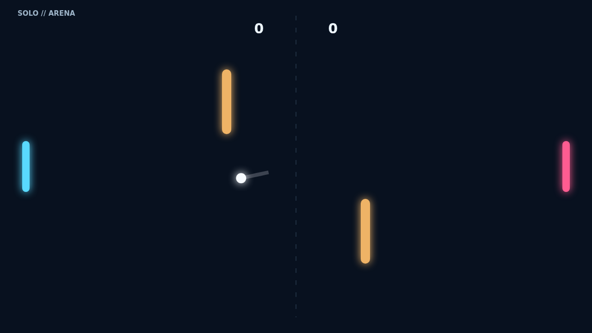

# Carom

Carom is a compact paddle duel where every rally is a geometry problem. The
opening serve crosses a dark arena threaded with two amber obstacles, and the
first player to build an eleven-point lead by two takes the match.

Paddle position controls the rebound angle, but motion matters just as much.
Meet the ball while sliding and the spin bends its flight after contact, turning
a safe return into a curving bank shot or a dangerous miss.

In Solo, the opposing paddle reads the incoming line and retreats to center
between attacks. Versus puts both paddles in human hands, making match point a
test of anticipation, speed, and who can find the better route through the
obstacles.

